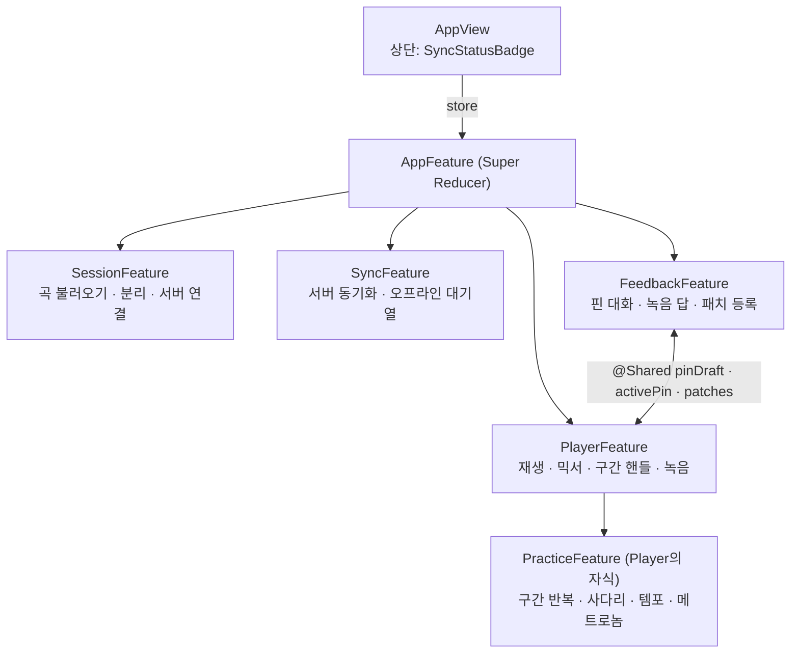
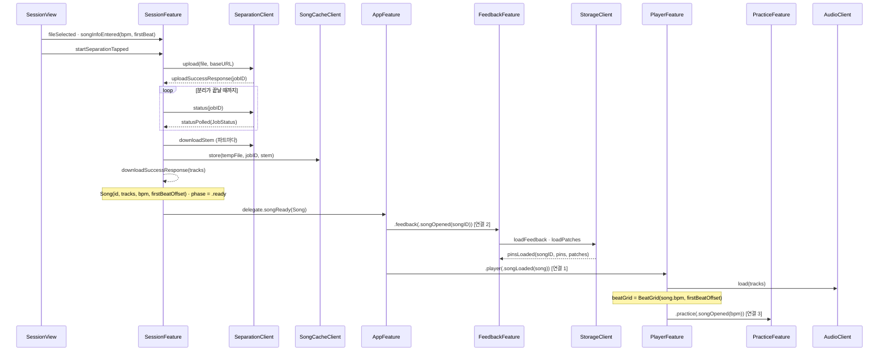
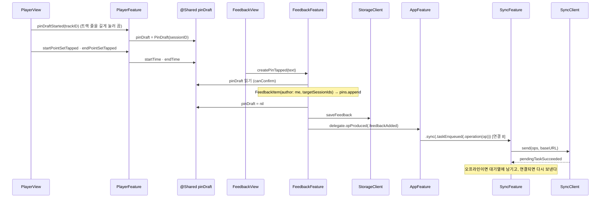
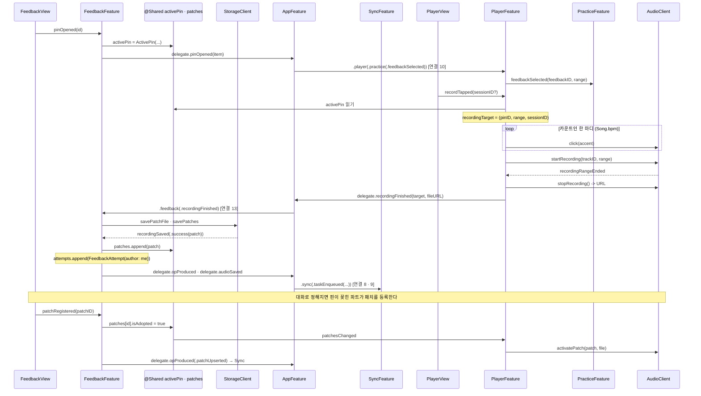
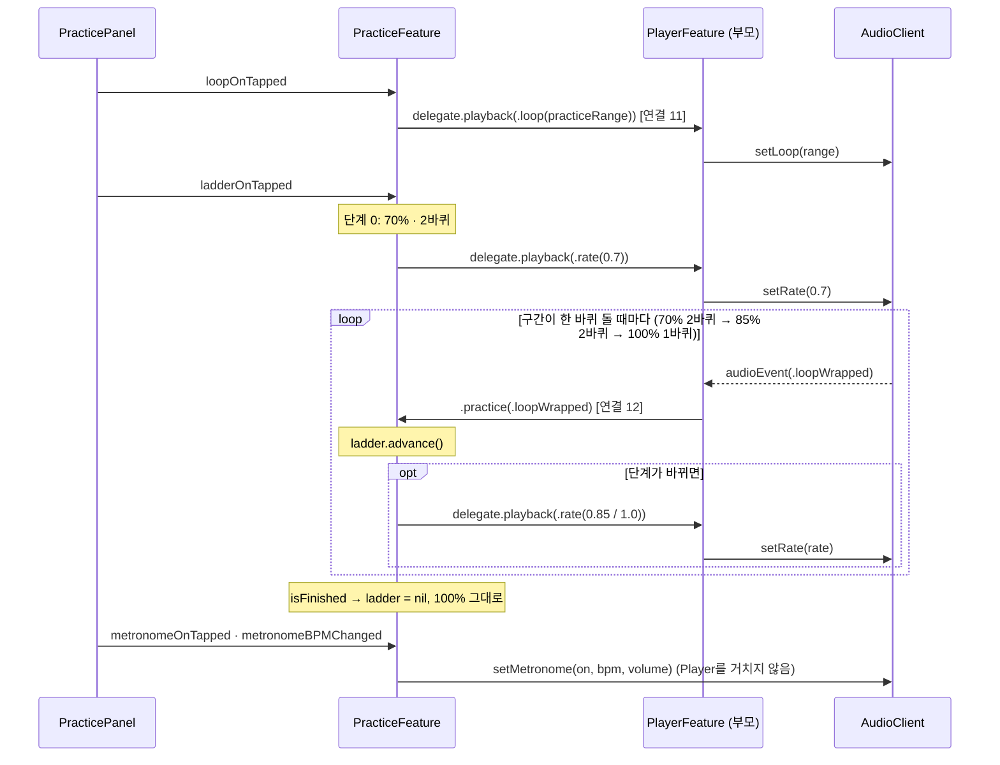
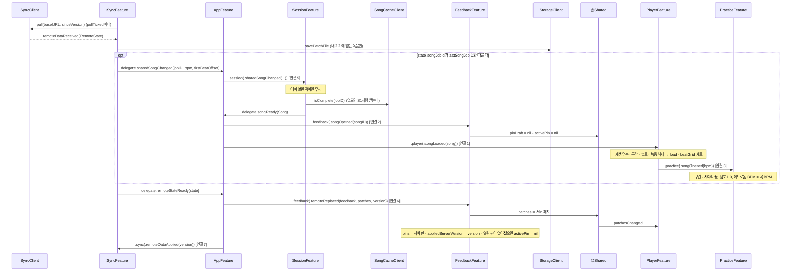

# Syncy 아키텍처

Syncy는 밴드 합주 iPad 앱이다. 곡을 파트별로 분리해 재생하고, 트랙 줄에 핀을 꽂아 글과 녹음으로 피드백을 주고받는다. SwiftUI와 TCA(The Composable Architecture)로 만든다.

이 문서는 **설계(목표)** 다. 코드가 이 문서와 다르면 코드를 설계에 맞춘다. 설계를 바꿔야 하면 먼저 팀과 정하고, 이 문서와 피그마를 함께 고친다. 담당과 작업 규칙은 저장소 맨 위의 `AGENTS.md`에 있다.

피그마 '뽀삐뽀삐' 보드의 그림

| 그림 | 보는 것 | 링크 |
|---|---|---|
| 개요도 | 전체 구조와 연결 표 | https://www.figma.com/board/6r8nEepkPqBkGNS7e9TBXy?node-id=329-2361 |
| 클래스 다이어그램 | Feature별 State · Action · 알림 · Client · 모델 | https://www.figma.com/board/6r8nEepkPqBkGNS7e9TBXy?node-id=332-2453 |
| 시퀀스 다이어그램 | 주요 흐름 다섯 장면 (S1~S5) | https://www.figma.com/board/6r8nEepkPqBkGNS7e9TBXy?node-id=355-2451 |
| Client 반환 타입 | Client 함수마다 받는 것 · 돌려주는 것 | https://www.figma.com/board/6r8nEepkPqBkGNS7e9TBXy?node-id=473-3012 |

---

## 1. 한눈에 보기



| Feature | 화면 | 하는 일 | Client |
|---|---|---|---|
| AppFeature | AppView | 자식 4개 조립 · 알림 전달 · 이 기기의 사람(`me`) | ProfileClient |
| SessionFeature | SessionView | 곡 고르기 · 업로드 · 분리 · 저장된 곡 · 공유 곡 열기 · 서버 연결 | SeparationClient · SongCacheClient |
| SyncFeature | SyncStatusBadge (AppView 상단 배지) | 서버와 핀 · 패치 동기화 · 오프라인 대기열 · 받은 녹음 저장 | SyncClient · StorageClient |
| FeedbackFeature | FeedbackView | 핀 만들기 · 핀 대화(글 · 녹음 답) · 패치 등록 | StorageClient |
| PlayerFeature | PlayerView | 재생 · 믹서 · 핀 구간 핸들 · 버전 고르기 · 녹음 · 패치 켜고 끄기 | AudioClient |
| PracticeFeature | PracticePanel (PlayerView 안) | 연습 구간 반복 · 연습 사다리 · 연습 템포 · 메트로놈 | AudioClient (메트로놈만) |

화면 구조는 Reducer 구조와 같다. AppView 안에 각 Feature 화면이 있고, PlayerView 안에 PracticePanel이 있다. Store는 AppView가 가진 하나뿐이고, 자식 화면에는 `scope`로 잘라서 넘긴다.

---

## 2. TCA 용어

| 용어 | 뜻 | 이 앱에서 |
|---|---|---|
| Feature | 화면(View) + Reducer + 필요한 Client를 묶은 단위 | Session · Sync · Feedback · Player · Practice |
| State | Feature가 지금 기억하는 값 | `SessionFeature.State` |
| Action | 일어난 일 (버튼 눌림, 응답 옴, 알림 옴) | `startSeparationTapped` |
| Reducer | Action이 오면 State를 바꾸고, 필요하면 Effect를 낸다 | `@Reducer struct SessionFeature` |
| Effect | Reducer가 바깥에 부탁하는 일. 결과는 다시 Action으로 돌아온다 | `.run { … }` |
| Client (`@Dependency`) | 서버 · 오디오 · 파일 같은 바깥 일. 진짜 · 테스트 · 미리보기 버전을 바꿔 끼운다 | `SeparationClient` |
| Store | 화면이 State를 보고 Action을 보내는 창구 | `StoreOf<AppFeature>` |
| Super Reducer | 자식 Reducer를 `Scope`로 조립하고 알림을 전달하는 맨 위 Reducer | `AppFeature` |
| 알림 (delegate) | 자식이 부모에게 "이런 일이 있었다"고 알리는 Action | `.delegate(.songReady(song))` |
| `@Shared` | 여러 Feature가 같이 보는 값 | `pinDraft` · `activePin` · `patches` |
| `@Presents` | 떴다 사라지는 화면(경고창 등)을 State로 관리 | `alert` |

---

## 3. Feature끼리 주고받는 방법

Feature끼리는 서로 직접 부르지 않는다. 방법은 세 가지뿐이다.

| 방법 | 언제 | 예 |
|---|---|---|
| 알림 → AppFeature가 전달 | 한 번 일어나는 사건을 알릴 때 | 곡 준비됨, 녹음 끝남 |
| `@Shared` 공유 값 | 같은 값을 계속 같이 볼 때 | 고르는 중인 핀 구간 |
| 부모와 자식이 직접 | Player와 Practice | 구간 반복 명령, 한 바퀴 돎 |

### 3.1 연결 표

AppFeature가 자식의 알림을 받아 받는 Feature의 Action으로 전달한다. 3 · 11 · 12번은 Player가 자식 Practice와 직접 주고받는다.

| # | 보내는 쪽 | 알림 | 받는 쪽 | 받는 Action | 하는 일 |
|---|---|---|---|---|---|
| 1 | Session | `songReady(Song)` | Player | `songLoaded(song)` | 곡을 재생 엔진에 올린다 |
| 2 | Session | `songReady(Song)` | Feedback | `songOpened(songID)` | 그 곡의 핀 · 녹음을 불러온다 |
| 3 | Player (부모) | (songLoaded 처리 중) | Practice (자식) | `.practice(.songOpened(bpm))` | 메트로놈 기본 BPM을 곡 BPM으로 |
| 4 | Session | `serverChanged(URL)` | Sync | `serverConfigured(URL)` | 동기화할 서버를 정한다 |
| 5 | Sync | `sharedSongChanged(jobID, bpm, firstBeatOffset)` | Session | `sharedSongChanged(jobID, bpm, firstBeatOffset)` | 공유 곡이 바뀌면 그 곡을 연다 |
| 6 | Sync | `remoteStateReady(state)` | Feedback | `remoteReplaced(feedback, patches, version)` | 서버의 핀 · 녹음으로 바꾼다 (5번 다음) |
| 7 | AppFeature | (6번 전달 후 직접) | Sync | `remoteDataApplied(version)` | 반영한 서버 버전을 기록한다 |
| 8 | Feedback | `opProduced(SyncOp)` | Sync | `taskEnqueued(.operation(op))` | 변경을 서버 대기열에 넣는다 |
| 9 | Feedback | `audioSaved(patchID, fileURL)` | Sync | `taskEnqueued(.audioUpload(patchID, fileURL))` | 녹음 파일을 서버에 올린다 |
| 10 | Feedback | `pinOpened(FeedbackItem)` | Player → Practice | `.player(.practice(.feedbackSelected(feedbackID, range)))` | 그 핀 구간으로 반복 연습을 준비한다 |
| 11 | Practice (자식) | `delegate.playback(PracticeCommand)` | Player (부모) | 자기 Reducer에서 처리 | 구간 반복 · 연습 템포를 바꾼다 |
| 12 | Player (부모) | (한 바퀴 돎) | Practice (자식) | `.practice(.loopWrapped)` | 바퀴를 세서 사다리 단계를 올린다 |
| 13 | Player | `recordingFinished(target, fileURL)` | Feedback | `recordingFinished(target, fileURL)` | 녹음을 핀의 답으로 저장한다 |
| 14 | AppFeature | (ProfileClient로 `me`를 읽은 뒤 직접) | Feedback | `meChanged(Person)` | 이 기기의 사람을 반영한다 |

새 연결이 필요하면 팀과 정한 뒤 `AppFeature`, 이 표, 피그마 개요도의 연결 표를 함께 고친다.

### 3.2 `@Shared` 공유 값

| 값 | 타입 | 바꾸는 쪽 | 읽는 쪽 |
|---|---|---|---|
| `pinDraft` | `PinDraft?` | Player (핸들로 구간 고르기), Feedback (핀을 만든 뒤 비우기) | Feedback (핀 만들기) |
| `activePin` | `ActivePin?` | Feedback (핀 열고 닫기) | Player (녹음 버튼) |
| `patches` | `IdentifiedArrayOf<Patch>` | Feedback | Player (버전 목록 · 패치 켜고 끄기) |

키는 `Models/SharedKeys.swift` 한 곳에만 둔다.

---

## 4. Feature별 설계

`Delegate`는 부모에게 보내는 알림이다.

### 4.1 AppFeature (Super Reducer)

화면 `AppView`: 각 Feature 화면을 품고, 상단에 `SyncStatusBadge`를 둔다.

State
- `me: Person`
- `session: SessionFeature.State`
- `sync: SyncFeature.State`
- `feedback: FeedbackFeature.State`
- `player: PlayerFeature.State` (Practice는 이 안에 있다)
- `@Dependency profileClient`

Action
- `task`: ProfileClient로 `me`를 읽고, 각 Feature의 시작 작업을 시킨다
- `meChanged(Person)`
- 자식 Action 4개: `.session` · `.sync` · `.feedback` · `.player`

자식의 알림은 [연결 표](#31-연결-표)대로 전달한다.

### 4.2 SessionFeature

화면 `SessionView`: 곡 선택 · 업로드, 곡 BPM · 첫 박 입력(곡을 올리는 사람), 분리 진행 표시, 저장된 곡 · 공유 곡 열기, 서버 연결 설정.

State
- `phase: SessionPhase = .idle`
- `selectedFileURL: URL?`
- `separationJobID: String?`
- `tracks: [SongTrack] = []`
- `songBPM: Double = 120`: 올릴 때 입력값. 곡이 준비되면 `Song.bpm`이 된다
- `firstBeatOffset: TimeInterval = 0`: 올릴 때 입력값. 곡이 준비되면 `Song.firstBeatOffset`이 된다
- `serverURL: URL?`
- `serverStatus: ServerStatus`
- `sharedSongJobID: String?`
- `cachedSongJobID: String?`
- `@Dependency separationClient` · `@Dependency songCacheClient`

Action
- `task`: 서버 찾기 · 저장된 곡 확인
- `serverDetected(URL?)` · `serverURLEntered(URL)`
- `fileSelected(fileURL: URL)` · `songInfoEntered(bpm, firstBeat)`
- `startSeparationTapped`
- `uploadSuccessResponse(jobID)` · `uploadFailureResponse(reason)`
- `statusPolled(JobStatus)`
- `separationSuccessResponse` · `separationFailureResponse(reason)`
- `downloadSuccessResponse(tracks)` · `downloadFailureResponse(reason)`
- `openSavedSongTapped`
- `sharedSongChanged(jobID, bpm, firstBeatOffset)`: 이미 열린 곡이면 무시
- `retryTapped`

Delegate
- `songReady(Song)`
- `serverChanged(URL)`

### 4.3 SyncFeature

화면 `SyncStatusBadge`: 동기화 상태(동기화됨 · 오프라인), 다시 시도 버튼.

State
- `status: SyncStatus = .idle`
- `serverURL: URL?`
- `pendingTasks: [PendingSyncTask]`: 아직 못 보낸 일
- `lastAppliedServerVersion: Int?`
- `lastSongJobID: String?`: 서버의 공유 곡이 이 값과 다를 때만 `sharedSongChanged`를 보낸다
- `@Dependency syncClient`
- `@Dependency storageClient`: 받은 녹음 파일 저장

Action
- `serverConfigured(URL)`
- `pollTicked`: 주기 확인
- `syncRequested`
- `taskEnqueued(PendingSyncTask)`
- `pendingTaskSucceeded` · `pendingTaskFailed(reason)`
- `remoteDataReceived(RemoteState)`
- `remoteDataFailed(reason)`
- `remoteDataApplied(version)`
- `retryTapped`

Delegate
- `remoteStateReady(RemoteState)`
- `sharedSongChanged(jobID, bpm, firstBeatOffset)`

### 4.4 FeedbackFeature

화면 `FeedbackView`: 핀 목록, 핀 만들기(구간 확인 → 글), 핀 대화(글 · 녹음 답), 패치 등록(핀이 꽂힌 파트만).

State
- `me: Person`
- `songID: String?`
- `pins: IdentifiedArrayOf<FeedbackItem>`
- `@Shared pinDraft: PinDraft?`
- `@Shared activePin: ActivePin?`
- `@Shared patches: IdentifiedArrayOf<Patch>`
- `appliedServerVersion: Int?`: 서버 데이터를 받았는지
- `@Presents alert: AlertState?`
- `@Dependency storageClient`

Action
- `songOpened(songID)`: 핀 목록을 비우고 `appliedServerVersion = nil`
- `pinsLoaded(songID, pins, patches)`: songID가 다르거나 서버 데이터를 이미 받았으면 버린다
- `meChanged(Person)`
- `createPinTapped(text)`: `pinDraft`로 핀을 만들고 `pinDraft`를 비운다
- `pinDraftCancelled`
- `pinDeleted`: 작성자만
- `pinOpened(id)` / `pinClosed`: `activePin` 설정
- `commentPosted` / `commentDeleted`
- `recordingFinished(target, fileURL)`
- `recordingSaved(Result<Patch>)`
- `patchRegistered`: 핀이 꽂힌 파트만
- `patchUnregistered` / `patchDeleted`
- `remoteReplaced(feedback, patches, version)`: 열린 핀이 없어졌으면 `activePin = nil`

Delegate
- `opProduced(SyncOp)`
- `audioSaved(patchID, fileURL)`
- `pinOpened(FeedbackItem)`

### 4.5 PlayerFeature

화면 `PlayerView`: 트랜스포트(재생 · 위치), 트랙 줄 · 믹서(볼륨 · 뮤트 · 솔로), 핀 구간 핸들(`pinDraft`), 버전 고르기(원본 · 새 버전), 녹음 버튼 · 카운트인 표시, `PracticePanel`(`scope: practice`).

State
- `tracks: IdentifiedArrayOf<TrackState>`
- `loadPhase: LoadPhase = .idle`
- `isPlaying: Bool = false`
- `playbackRate: Float = 1.0`
- `loopRange: ClosedRange<TimeInterval>?`
- `soloTrackID: SessionID?`
- `recordingPhase: RecordingPhase`
- `recordingTarget: RecordingTarget?`
- `@Shared pinDraft`: 핸들로 고친다
- `@Shared activePin`: 읽기 (녹음 버튼)
- `@Shared patches`: 읽기 · 변화 관찰
- `practice: PracticeFeature.State`: 자식
- `@Presents destination`
- `beatGrid: BeatGrid`: `Song.bpm`으로 만든다 (마디 칸 · 핸들 · 카운트인)
- `@Dependency audioClient`

재생 위치는 State에 넣지 않는다. 초당 여러 번 바뀌기 때문에, 재생바 화면이 `AudioClient.position()`을 직접 구독한다.

Action
- `task` / `playPauseTapped`
- `seekChanged(time)`
- `volumeChanged(trackID, volume)`
- `muteTapped` / `soloTapped`
- `pinDraftStarted(trackID)` · `startPointSetTapped(time)` · `endPointSetTapped(time)`
- `patchSelected(patch)` · `originalSelected(trackID, range)`
- `songLoaded(song)` / `loadResponse`
- `patchesChanged`: `@Shared patches`에서 `isAdopted`가 바뀐 패치만 `activatePatch` / `deactivatePatch`
- `practice(PracticeFeature.Action)`: 자식. `delegate.playback`은 여기서 처리한다
- `recordTapped(sessionID?)` · `recordCancelTapped`
- `audioEvent(AudioEvent)` / `countInTicked`
- `countInFinished` / `recordingRangeEnded`
- `recordingResponse(Result<URL>)`
- `destination(...)`

Delegate
- `recordingFinished(target, fileURL)`

### 4.6 PracticeFeature (PlayerFeature의 자식)

화면 `PracticePanel` (PlayerView 안 패널): 연습 구간 · 구간 반복, 사다리 켜고 끄기 · 단계 표시, 연습 템포, 메트로놈 BPM · 볼륨 · 켜고 끄기.

State
- `selectedFeedbackID: UUID?`
- `practiceRange: ClosedRange<TimeInterval>?`
- `isLoopEnabled: Bool = false`
- `ladder: PracticeLadder?`: 켜져 있으면 단계 · 바퀴 수
- `tempo: Float = 1.0`: 연습 템포 (재생 속도)
- `isMetronomeEnabled: Bool`
- `metronomeVolume: Int`: 0~100
- `metronomeBPM: Double`: 0보다 큼
- `@Dependency audioClient`: 메트로놈만

Action
- `songOpened(bpm)`: 메트로놈 기본값
- `feedbackSelected(feedbackID, range)`: 핀이 열리면 그 구간을 연습 구간으로
- `practiceRangeChanged(range)`
- `loopOnTapped` / `loopOffTapped`
- `ladderOnTapped` / `ladderOffTapped`
- `loopWrapped`: 바퀴를 세서 단계를 올린다
- `tempoChanged(Float)`
- `metronomeOnTapped` / `metronomeOffTapped`
- `metronomeVolumeChanged(Int)` · `metronomeBPMChanged(Double)`

Delegate
- `playback(PracticeCommand)`: 부모 PlayerFeature가 받는다

---

## 5. Client

바깥 일(서버 · 오디오 · 파일)은 모두 Client로 한다. Reducer는 Client만 알고, 실제 일은 Service가 한다.

| 이름 | 하는 일 |
|---|---|
| `○○Client` | 함수 목록(`@DependencyClient` 구조체) + `liveValue` · `previewValue` · `testValue`. Reducer가 `@Dependency`로 부른다 |
| `○○Service` | 실제 일을 하는 코드(HTTP · AVAudioEngine · 파일). TCA를 모른다. `liveValue`가 Service를 부른다 |

"실패하면" 칸: **던짐**은 실패하면 에러를 던진다(Reducer는 `.success` / `.failure`로 받는다). **안 던짐**은 실패해도 값으로 알려 준다.

### SeparationClient (Session)

| 함수 | 돌려주는 것 | 실패하면 · 설명 |
|---|---|---|
| `health(baseURL)` | `Bool` | 안 던짐. 실패하면 `false` |
| `upload(file: URL, baseURL)` | `String` (jobID) | 던짐 |
| `status(jobID, baseURL)` | `JobStatus` | 던짐 |
| `downloadStem(jobID, stem: SessionID, baseURL)` | `URL` | 던짐. 받은 파트 파일의 임시 위치 |

### SongCacheClient (Session)

| 함수 | 돌려주는 것 | 실패하면 · 설명 |
|---|---|---|
| `cachedURL(jobID, stem)` | `URL?` | 없으면 `nil` |
| `isComplete(jobID)` | `Bool` | 파트가 다 있으면 `true` |
| `store(tempFile: URL, jobID, stem)` | `URL` | 던짐. 임시 파일을 옮긴 영구 위치 |
| `lastJobID()` | `String?` | 마지막으로 연 곡 |
| `markOpened(jobID)` | `Void` | 열어 본 곡으로 기록. 최근 2곡만 남긴다 |

### SyncClient (Sync)

| 함수 | 돌려주는 것 | 실패하면 · 설명 |
|---|---|---|
| `send(ops, baseURL)` | `Void` | 던짐. 쌓인 변경을 순서대로 보낸다 |
| `pull(baseURL, sinceVersion)` | `RemoteState?` | 던짐. 서버 버전이 같으면 `nil` |
| `uploadAudio(patchID, file, baseURL)` | `Void` | 던짐 |
| `downloadAudio(patchID, baseURL)` | `URL` | 던짐. 받은 녹음 파일의 위치 |

### StorageClient (Feedback · Sync)

| 함수 | 돌려주는 것 | 실패하면 · 설명 |
|---|---|---|
| `loadFeedback(songID)` | `[FeedbackItem]` | 던짐. 없으면 빈 배열 |
| `saveFeedback(songID, items)` | `Void` | 던짐 |
| `loadPatches(songID)` | `[Patch]` | 던짐. 없으면 빈 배열 |
| `savePatches(songID, patches)` | `Void` | 던짐 |
| `savePatchFile(tempFile, patchID, songID)` | `URL` | 던짐. 녹음 임시 파일을 옮긴 저장 위치 |
| `patchFileURL(patchID, songID)` | `URL` | 저장된 패치 파일의 위치 |

### AudioClient (Player · Practice는 메트로놈만)

| 함수 | 돌려주는 것 | 실패하면 · 설명 |
|---|---|---|
| `load(tracks)` | `TimeInterval` | 던짐. 곡 전체 길이(초) |
| `play()` | `Void` | 던짐 |
| `pause()` · `seek(time)` | `Void` | |
| `setRate(rate)` | `Void` | 재생 속도 (사다리 · 연습 템포) |
| `setLoop(range?)` | `Void` | `nil`이면 반복 끔 |
| `setVolume(trackID, volume)` · `setMuted(trackID, muted)` · `setSolo(trackID?)` | `Void` | |
| `activatePatch(patch, file)` | `Bool` | 켜졌으면 `true`. 같은 파트에서 구간이 겹치는 패치는 엔진이 끈다 |
| `deactivatePatch(patchID, trackID)` | `Void` | |
| `startRecording(trackID, range)` | `Void` | 던짐. 마이크 권한을 묻고 시작한다 (그 트랙은 뮤트, 원래 속도) |
| `stopRecording()` | `URL` | 던짐. 녹음 파일의 임시 위치 |
| `cancelRecording()` | `Void` | 녹음을 버린다 |
| `click(accent: Bool)` | `Void` | 카운트인 딸깍. `true`면 첫 박(강하게) |
| `setMetronome(on, bpm, volume)` | `Void` | Practice가 직접 부른다 |
| `events()` | `AsyncStream<AudioEvent>` | 엔진이 혼자서도 알려 주는 일 |
| `position()` | `AsyncStream<TimeInterval>` | 재생 위치. 재생바 화면이 직접 구독한다 |

### ProfileClient (AppFeature)

| 함수 | 돌려주는 것 | 설명 |
|---|---|---|
| `current()` | `Person` | 이 기기의 사람 |
| `set(person)` | `Void` | 기기에 저장 |

---

## 6. 모델 · enum

### 앱 전체

| 타입 | 내용 |
|---|---|
| `Person` | `id: UUID` · `name: String` · `part: SessionID`(맡은 파트). 모두 같은 권한이다 |
| `SessionID` (enum) | 파트 ID. 트랙 ID와 같다: `vocals` · `drums` · `bass` · `guitar` · `piano`. rawValue는 분리 서버의 파트 이름과 같다 |

### 곡

| 타입 | 내용 |
|---|---|
| `Song` | `id: String` · `tracks: [SongTrack]` · `bpm: Double = 120`(곡 BPM의 기준) · `firstBeatOffset: TimeInterval` |
| `SongTrack` | `id: SessionID` · `fileURL: URL` |
| `JobStatus` | `state: State`(`queued` · `processing` · `done` · `error`) · `stems: [SessionID]` · `error: String?`. `SeparationClient.status()`의 결과 |
| `SessionPhase` (enum) | `idle` · `uploading` · `uploadFailed(reason)` · `separating` · `separationFailed(reason)` · `downloading` · `downloadFailed(reason)` · `ready` |
| `ServerStatus` (enum) | `searching` · `connected(name)` · `notFound` |

### 동기화

| 타입 | 내용 |
|---|---|
| `RemoteState` | `version: Int` · `songJobId: String?` · `songBPM: Double?` · `firstBeatOffset: TimeInterval?` · `feedback: [FeedbackItem]?` · `patches: [Patch]?` |
| `SyncStatus` (enum) | `idle` · `syncing` · `synced` · `failed(reason)` |
| `PendingSyncTask` (enum) | `operation(SyncOp)` · `audioUpload(patchID, fileURL)` |
| `SyncOp` (enum) | `feedbackAdded` / `feedbackDeleted` · `attemptAdded` / `attemptDeleted` · `commentAdded` / `commentDeleted` · `patchUpserted` / `patchDeleted` |

### 핀 대화

| 타입 | 내용 |
|---|---|
| `FeedbackItem` (핀) | `id: UUID` · `startTime`, `endTime` · `createdAt` · `text` · `author: Person` · `translations: [String: String]?` · `targetSessionIds: [SessionID]` · `attempts: [FeedbackAttempt]` · `comments: [FeedbackComment]`. 함수: `canDelete(by: Person)` · `status(for: SessionID, patches:)` · `lastSpeaker` · `timeRange` |
| `FeedbackAttempt` (녹음 답) | `id: UUID` · `author: Person` · `sessionId: SessionID` · `patchId: UUID` · `createdAt` · `comments: [FeedbackComment]` |
| `FeedbackComment` (글) | `id: UUID` · `author: Person` · `text` · `createdAt` · `translations: [String: String]?` |
| `FeedbackStatus` (enum) | `discussing`(이야기 중) · `applied`(패치 등록됨, 파트별) |
| `Patch` (녹음 조각) | `id: UUID` · `sessionId: SessionID` · `startTime`, `endTime` · `createdAt` · `sourceStart` · `isAdopted: Bool`(패치 등록됨). 함수: `timeRange` · `duration` |
| `PinDraft` (고르는 중인 구간) | `sessionID: SessionID` · `startTime: TimeInterval?` · `endTime: TimeInterval?`. 함수: `range` · `canConfirm`(끝이 시작보다 뒤) |
| `ActivePin` (열린 핀) | `pinID: UUID` · `range: ClosedRange<TimeInterval>` · `sessionIDs: [SessionID]` |

### 재생 · 녹음

| 타입 | 내용 |
|---|---|
| `TrackState` | `id: SessionID` · `volume: Float` · `isMuted: Bool` · `activePatchIDs: Set<UUID>` |
| `RecordingTarget` | `pinID: UUID` · `range: ClosedRange<TimeInterval>` · `sessionID: SessionID`(녹음할 파트). 녹음한 사람은 Feedback이 `me`로 채운다 |
| `RecordingPhase` (enum) | `idle` · `countIn(beat)` · `recording` · `finishing` |
| `LoadPhase` (enum) | `idle` · `loading` · `ready` · `failed(reason)` |
| `PlayerDestination` (enum) | `alert(AlertState)` |
| `AudioEvent` (enum) | `loopWrapped`(구간 반복 한 바퀴) · `playbackEnded` · `recordingFailed(reason)` · `interrupted`(전화 등) |

### 연습

| 타입 | 내용 |
|---|---|
| `PracticeLadder` | `steps: [Float] = [0.7, 0.85, 1.0]` · `loopsPerStep: [Int] = [2, 2, 1]` · `stepIndex: Int` · `loopsDone: Int`. 함수: `currentRate` · `isFinished` · `advance()` |
| `PracticeCommand` (enum) | `loop(ClosedRange<TimeInterval>?)` · `rate(Float)` · `stop` |
| `BeatGrid` | `bpm: Double`(= `Song.bpm`) · `firstBeatOffset: TimeInterval` · `beatsPerBar: Int = 4`. 함수: `position(at: time) -> MusicalPosition` · `time(of: MusicalPosition)` |
| `MusicalPosition` | `measure: Int`(1 이상) · `beat: Int`(1~4). 화면 표시용 |

---

## 7. 주요 흐름

`[연결 N]`은 3.1 연결 표의 번호다.

### S1. 곡 올리고 열기 (올리는 기기)



서버는 이 곡을 공유 곡으로 기록한다. 다른 기기는 S5 순서로 같은 곡을 연다.

### S2. 핀 만들기



핀 삭제는 작성자만 한다: `pinDeleted` → `canDelete(by: me)` → `saveFeedback` → `opProduced(.feedbackDeleted)` → 같은 길로 Sync.

### S3. 핀 열고 녹음 답 → 저장 → 업로드 → 패치 등록



다른 기기에서 등록한 패치도 S5에서 `patches`가 바뀌면 같은 길로 켜진다.

### S4. 연습 사다리 · 메트로놈



연습 템포(재생 속도)와 메트로놈 BPM은 따로 움직인다. 사다리는 재생 속도만 바꾼다.

### S5. 다른 기기: 서버 변경 받기 · 곡이 바뀌면 초기화



늦게 끝난 `pinsLoaded`는 서버 데이터를 이미 받았으면 버린다. 그래서 기기에 있던 핀이 서버의 최신 핀을 덮어쓰지 않는다.

---

## 8. 기능 규칙

핀 대화
- 트랙 줄을 길게 눌러 구간을 고르면 그 파트에 핀이 꽂힌다.
- 핀 대화는 글과 녹음 답만 있다. 녹음 답은 누구나, 횟수 제한 없이 단다.
- 대화로 정해지면 핀이 꽂힌 파트가 각자 패치를 등록한다. 여러 파트에 꽂힌 핀은 파트마다 따로 등록한다.
- 핀은 작성자만 지운다.
- 모든 밴드원은 같은 권한이다.

시간 · 템포
- 시간은 저장 · 전달 모두 초(`TimeInterval`)다. 마디 · 박은 화면 표시용이고 `BeatGrid`로 바꾼다.
- 곡 BPM은 `Song.bpm` 하나다. 곡을 올리는 사람이 입력하고, 없으면 120이다. 첫 박 위치도 같이 입력한다.
- 카운트인은 곡 BPM으로 1배속 한 마디(4박)다.

연습
- 연습 사다리는 재생 속도를 70 → 85 → 100%로, 2 · 2 · 1바퀴씩 올린다. 켜고 끄기만 있다.
- 메트로놈 BPM은 사용자가 정하고, 재생 속도와 따로 움직인다.

역할
- 핀 만들기는 Feedback, 녹음 버튼은 Player, 연습은 Practice가 맡는다.
- 패치 켜고 끄기는 Player가 `@Shared patches`를 보고 직접 한다.
- 오류 표시는 `@Presents alert`로 한다.

---

## 9. 디렉토리 구조

Xcode 프로젝트 `Syncy/Syncy.xcodeproj`의 앱 타깃 `Syncy`. 하나의 타깃 안에서 폴더(Xcode의 파란 폴더)로 나눈다. 테스트 타깃은 아직 없다. `(아직 없음)`은 필요해질 때 만든다.

```text
Syncy
├─ App
│  ├─ SyncyApp.swift                     @main
│  ├─ AppFeature.swift                   Super Reducer: 자식 4개 조립 · 연결 표 · me
│  └─ AppView.swift                      Super View: 각 화면 + 상단 SyncStatusBadge
│
├─ Core
│  ├─ Components                         (아직 없음) 여러 화면이 같이 쓰는 UI
│  ├─ Theme                              (아직 없음) 색 · 간격 (파트별 색 포함)
│  ├─ Constants
│  │  └─ SystemSettingsURL.swift         iPad 설정 열기 (마이크 권한 등)
│  └─ Extensions
│     ├─ Color+.swift                    hex 색
│     └─ Duration+.swift                 Duration → TimeInterval
│
├─ Dependencies
│  ├─ ProfileClient.swift                짧아서 파일 하나
│  ├─ SongCacheClient.swift              짧아서 파일 하나
│  ├─ SeparationClient
│  │  ├─ SeparationClient.swift
│  │  ├─ SeparationService.swift         분리 서버 HTTP
│  │  └─ JobStatus.swift
│  ├─ SyncClient
│  │  ├─ SyncClient.swift
│  │  └─ SyncService.swift               동기화 서버 HTTP
│  ├─ StorageClient
│  │  ├─ StorageClient.swift
│  │  └─ StorageService.swift            파일 읽고 쓰기
│  └─ AudioClient
│     ├─ AudioClient.swift
│     ├─ AudioService.swift              AVAudioEngine 재생 · 녹음 · 메트로놈
│     └─ AudioEvent.swift
│
├─ Features
│  ├─ SessionFeature
│  │  ├─ SessionFeature.swift
│  │  ├─ SessionView.swift
│  │  ├─ SessionPhase.swift
│  │  └─ ServerStatus.swift
│  ├─ SyncFeature
│  │  ├─ SyncFeature.swift
│  │  ├─ SyncStatusBadge.swift
│  │  ├─ SyncStatus.swift
│  │  └─ PendingSyncTask.swift
│  ├─ FeedbackFeature
│  │  ├─ FeedbackFeature.swift
│  │  ├─ FeedbackView.swift
│  │  └─ FeedbackStatus.swift
│  └─ PlayerFeature
│     ├─ PlayerFeature.swift
│     ├─ PlayerView.swift
│     ├─ TrackState.swift
│     ├─ LoadPhase.swift
│     ├─ RecordingPhase.swift
│     ├─ PlayerDestination.swift
│     └─ PracticeFeature
│        ├─ PracticeFeature.swift
│        ├─ PracticePanel.swift
│        ├─ PracticeLadder.swift
│        └─ PracticeCommand.swift
│
├─ Models
│  ├─ Person.swift · SessionID.swift · Song.swift · SongTrack.swift
│  ├─ FeedbackItem.swift · FeedbackAttempt.swift · FeedbackComment.swift · Patch.swift
│  ├─ RecordingTarget.swift · RemoteState.swift · SyncOp.swift · BeatGrid.swift
│  └─ PinDraft.swift · ActivePin.swift · SharedKeys.swift
│
└─ Resources
   ├─ Assets.xcassets
   └─ Sounds                             (아직 없음) 카운트인 · 메트로놈 클릭 소리
```

### 어디에 둘지

| 이런 것은 | 여기에 |
|---|---|
| 화면 | 그 Feature 폴더 (AppView만 `App`) |
| 한 Feature만 쓰는 타입 | 그 Feature 폴더 |
| 두 Feature 이상이 쓰는 데이터, `@Shared` 값 | `Models` |
| 부모-자식 Feature | 자식 폴더를 부모 폴더 안에 |
| 실제 일이 긴 Client | `Dependencies/○○Client/` 안에 `○○Client.swift` + `○○Service.swift` |
| 실제 일이 짧은 Client | `Dependencies/○○Client.swift` 하나 |
| 그 Client만 쓰는 타입 (반환값 · 이벤트) | 그 Client 폴더 (`JobStatus`, `AudioEvent`) |
| 여러 화면이 같이 쓰는 UI · 색 | `Core/Components` · `Core/Theme` |
| 앱 설정값 (서버 주소, 시간 간격, 설정 URL) | `Core/Constants` |
| 표준 타입 확장 | `Core/Extensions` |
| 이미지 · 소리 | `Resources` |

필요해지면
- `○○ServiceError.swift`: 실패 이유를 구분해서 보여 줘야 할 때 Client 폴더에 추가한다.
- `PlayerFeature+Recording.swift` · `PlayerFeature+Patches.swift`: `PlayerFeature.swift`가 길어지면 extension 파일로 나눈다.
- Feature 폴더 안 `Views/`: 화면 조각이 많아지면 모은다.
